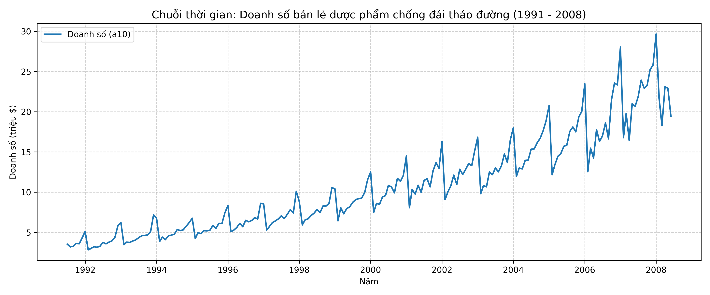

# Báo cáo Thực hành - Bài 1: Khám phá dữ liệu (EDA)

## 1. Biểu đồ chuỗi thời gian

## 2. Trả lời câu hỏi phân tích

### Chuỗi có xu hướng (Trend) không?
- Có. Đồ thị thể hiện một xu hướng tăng trưởng dài hạn rất rõ rệt (Upward Trend) từ năm 1991 đến năm 2008 (tăng từ khoảng 3.5 triệu USD lên hơn 20 triệu USD).

### Có dấu hiệu mùa vụ (Seasonality) không?
- Có. Dữ liệu có chu kỳ lặp lại theo chu kỳ 12 tháng (mùa vụ hàng năm):
  - Doanh số luôn đạt đỉnh (spike) vào khoảng tháng 12 hoặc tháng 1 đầu năm tiếp theo.
  - Doanh số giảm mạnh đột ngột (drop) vào tháng 2 hàng năm.

### Chuỗi có khả năng dừng (Stationary) không?
- Không có khả năng dừng. 
  - Giá trị trung bình (mean) tăng liên tục theo thời gian (do xu hướng tăng).
  - Phương sai (variance) có dấu hiệu mở rộng theo thời gian (biên độ dao động các năm sau lớn hơn các năm đầu).
  - Chuỗi không thỏa mãn điều kiện có kỳ vọng và phương sai không đổi. Cần kiểm định định lượng bằng ADF ở Bài 2 để xác nhận.
